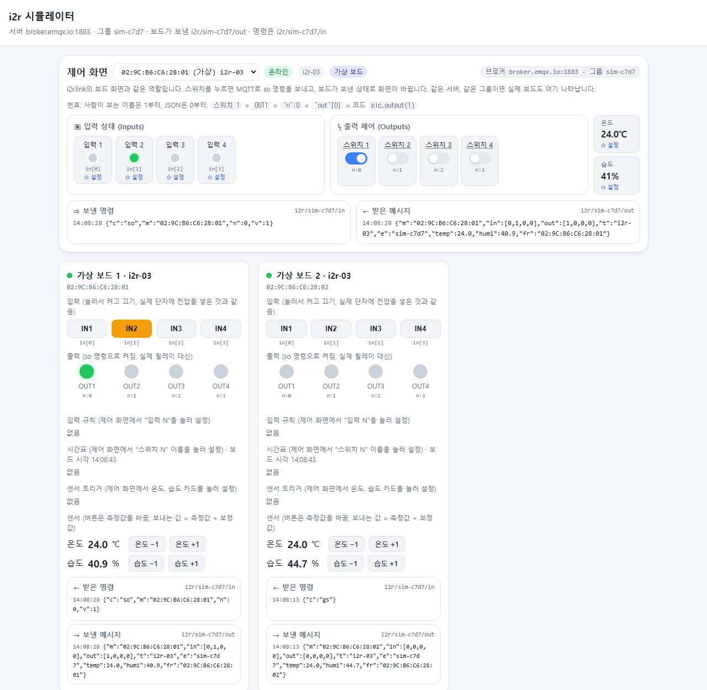

# i2r-server

i2r 보드(IoT PLC i2r-02/03/04, Otto 로봇)와 **같은 i2r 프로토콜**로 동작하는 서버 쪽 프로그램을 모은 저장소입니다.

| 폴더 | 내용 | 상태 |
|---|---|:---:|
| [protocol.md](protocol.md) | **i2r 통신 프로토콜 원본** (토픽, 봉투, 명령, 오류). 보드, 서버, 웹이 모두 이것을 따름 | ✅ |
| [sim/](sim/) | **시뮬레이터**: PC에 가상 i2r 보드를 띄우고, 제어 화면과 프로토콜 시험을 함께 제공 | ✅ |
| `local/` | 로컬 서버: 내 PC나 i2r-05에 MQTT 브로커, 백엔드, 대시보드 설치 | 🛠️ 만드는 중 |
| `aws/` | 아마존(EC2) 개인 서버 설치 | 🛠️ 만드는 중 |
| `common/` | local과 aws가 함께 쓰는 코드 (브로커 설정, 백엔드, 대시보드 틀) | 🛠️ 만드는 중 |

## ✅ MQTT 서버

### MQTT가 왜 필요한가요

i2r 보드는 공유기(Wi-Fi) 뒤에 있어서, 바깥의 PC나 휴대폰이 보드 주소를 알고 바로 접속하기 어렵습니다.
그래서 보드와 화면(시뮬레이터, 대시보드, 앱)이 서로 직접 연결하지 않고, **둘 다 인터넷의 MQTT 서버(브로커)에 접속해서 그곳을 거쳐** 메시지를 주고받습니다.

```
 제어 화면 (PC, 휴대폰)  ──┐                     ┌──  실제 보드 (i2r-02/03/04, Otto)
                           ├──  MQTT 서버(브로커) ──┤
 시험 프로그램           ──┘                     └──  가상 보드 (시뮬레이터)
```

### MQTT 서버의 역할

| 역할 | 내용 |
|---|---|
| 우체국 | 메시지를 받아서 그 **토픽**을 구독한 쪽에 전해 줍니다. 서버는 내용을 바꾸거나 해석하지 않습니다 |
| 토픽으로 나누기 | 보드는 `i2r/<그룹>/out`으로 상태를 보내고, `i2r/<그룹>/in`으로 명령을 받습니다. 그룹이 같아야 서로 메시지가 닿습니다 |
| 여러 곳에 한 번에 | 보드가 상태를 한 번 보내면, 같은 토픽을 보는 화면 여러 개가 동시에 받습니다 |
| 온라인/오프라인 알림 | 보드가 접속할 때 미리 맡겨 둔 메시지(Last Will)를, 보드가 갑자기 끊기면 서버가 대신 보내 줍니다 (`{"c":"lw","on":0}`) |

그래서 **보드, 시뮬레이터, 시험 프로그램이 모두 같은 서버, 같은 그룹**을 써야 서로 보입니다.

### 서버 고르기

켤 때 목록에서 고릅니다. 기본은 공개 시험 서버 `test.mosquitto.org:1883`이고, 화면에 보드가 늦게 나타나거나 응답이 느리면 2번 `broker.emqx.io`를 고릅니다.

- 실제 보드와 같이 쓸 때는 **보드도 같은 서버**여야 합니다. 보드 서버는 I2R_IoT의 `tools/send-si.ps1`로 바꿉니다. 시뮬레이터만 바꾸면 화면에 보드가 나타나지 않습니다.

- 공개 서버는 **누구나 토픽을 볼 수 있습니다.** 개인 정보, 비밀번호를 메시지에 넣지 마세요.
- 그래서 시뮬레이터는 실행할 때마다 그룹 이름을 `sim-` 뒤 임의 코드로 바꾸고, 공개 서버에는 가상 보드를 5대까지만 붙입니다.
- 실제 보드를 시험할 때는 보드의 MAC과 그룹을 공개된 곳에 적지 마세요. 그 값을 아는 사람은 같은 서버에서 보드에 명령을 보낼 수 있습니다.

## ✅ 관련 저장소

| 저장소 | 내용 |
|---|---|
| [i2r](https://github.com/kdi6033/i2r) | i2r 통신 프로토콜 (MQTT 토픽, JSON 명령) |
| [I2R_IoT](https://github.com/kdi6033/I2R_IoT) | 보드 쪽 통신 라이브러리 (Wi-Fi, MQTT, 시간) |
| [I2R_PLC](https://github.com/kdi6033/I2R_PLC) | i2r-02/03/04 입출력 라이브러리 |
| [OttoI2R](https://github.com/kdi6033/OttoI2R) | Otto I2R 로봇 동작 라이브러리 (서보 4개 공통 제어) |
| [i2r-plc](https://github.com/kdi6033/i2r-plc) | IoT PLC AI 코딩 키트 |
| [otto](https://github.com/kdi6033/otto) | Otto I2R 로봇 AI 코딩 키트 |

## ✅ 시뮬레이터로 시작하기

보드 없이도 i2r 프로토콜을 확인할 수 있습니다. 가상 보드는 실제 보드 펌웨어와 같은 메시지를 주고받고, 릴레이 대신 화면의 LED가 켜지므로 안전합니다.



위는 **제어 화면**(i2r.link의 보드 화면과 같은 역할), 아래는 **가상 보드**입니다. 같은 서버, 같은 그룹이면 실제 보드도 제어 화면의 보드 목록에 나타납니다.

켜는 방법은 두 가지입니다.

### 방법 A: Claude Code로 한 줄 (추천)

내가 설치하는 것은 **Git, VS Code, Claude Code 확장** 3개뿐입니다. 빈 폴더를 VS Code로 열고 Claude에게 아래처럼 말합니다.

**처음 한 번**
```
https://github.com/kdi6033/i2r 읽고 i2r 개발을 도와줘. 시뮬레이터 켜 줘
```

Claude가 필요한 저장소(i2r-server)를 받고, Python과 라이브러리를 설치하고, 시뮬레이터를 켜고 화면을 엽니다. 나는 **MQTT 서버만 고르면** 됩니다.
이때 Claude가 내 PC에 **i2r 스킬**을 설치하므로(물어보고 설치), 그다음부터는 주소를 넣지 않아도 됩니다.

**그다음부터 (어느 폴더에서나)**
```
서버 개발을 도와줘
시뮬레이터 켜 줘
프로토콜 시험해 줘
최신으로 업데이트해 줘
```

PLC 키트(i2r-plc)나 Otto도 같은 방법으로 시작합니다. "plc 개발을 도와줘", "otto 개발을 도와줘"라고 하면 Claude가 필요한 저장소를 옆에 받아 줍니다.

> 채팅(claude.ai, ChatGPT)에서는 명령을 실행할 수 없어서 시뮬레이터를 켤 수 없습니다. 방법 B로 직접 켭니다.
> 예전 문장(`https://github.com/kdi6033/i2r-server 저장소를 이 폴더에 내려받고, 그 안의 CLAUDE.md를 읽은 다음 시뮬레이터를 켜 줘.`)도 계속 됩니다.

### 방법 B: 직접 켜기

**1. 준비 (처음 한 번)**

- [Python 3](https://www.python.org/downloads/)을 설치합니다. Windows에서는 설치 화면의 **Add python.exe to PATH**를 꼭 체크합니다.
- 이 저장소를 받습니다: `git clone https://github.com/kdi6033/i2r-server` (또는 **Code → Download ZIP**)
- MQTT 라이브러리를 설치합니다: `python -m pip install "paho-mqtt>=2.0"`

**2. 켜기**

```
cd i2r-server/sim
python sim.py --boards 2
```

Windows에서는 `sim/start-sim.bat`을 두 번 눌러도 됩니다 (가상 보드 1대, 라이브러리가 없으면 저절로 설치).

켜면 서버를 고르는 목록이 나옵니다. 번호를 넣거나 Enter(1번)를 누릅니다.

```
MQTT 서버를 고르세요 (실제 보드와 같이 쓰면 보드와 같은 서버여야 합니다)
  1) test.mosquitto.org   기본, 교육용 공개 서버
  2) broker.emqx.io       1번이 느리거나 안 될 때
  3) 직접 입력             i2r-05 로컬 서버, 아마존 서버
번호 (Enter = 1):
```

`--server broker.emqx.io`처럼 서버를 붙여 실행하면 목록 없이 바로 켜집니다.

**3. 화면**

브라우저에서 **http://localhost:8000** 이 저절로 열립니다.

| 누르는 곳 | 하는 일 |
|---|---|
| 가상 보드의 **IN1 ~ IN4** | 가상 입력 켜기/끄기 (실제 단자에 신호를 넣은 것과 같음) |
| 제어 화면의 **스위치 토글** | `so` 명령으로 출력 켜기/끄기 |
| 제어 화면의 **입력 N** | 입력 규칙 (`bio`): 입력이 들어오면 다른 출력 켜기 |
| 제어 화면의 **스위치 N** 이름 | 시간표 (`sch`): 정한 시간에 켜고 끄기 |
| 제어 화면의 **온도, 습도** 카드 | 센서 트리거와 보정 (`bs`) |
| 제어 화면 오른쪽 위 **브로커** | MQTT 서버와 그룹 바꾸기 (다시 켜지 않아도 됨) |
| 보드 목록의 **🔌 USB로 실제 보드 연결** | 실제 보드에 가상보드 프로그램 쓰기, Wi-Fi·서버 넣기, 보드 찾기 (Chrome, Edge). [실제 보드 연결하기](#-실제-보드-연결하기) 방법 C |

**4. 끄기**: 시뮬레이터 창에서 **Ctrl+C** 또는 창 닫기.

**5. 프로토콜 시험**: 가상 보드나 실제 보드에 프로토콜 규칙 시험(`gs`, `so`, `bio`, `sch`, `bs` 등)을 돌립니다. 그룹과 MAC은 시뮬레이터를 켤 때 창에 나옵니다.

```
python test_protocol.py --server test.mosquitto.org --group sim-1a2b --mac 02:AB:CD:EF:01:01
```

자세한 옵션(서버 바꾸기, 보드 수, i2r-04)과 메시지 형식은 [sim/README.md](sim/README.md)에 있습니다.

## ✅ 실제 보드 연결하기

시뮬레이터로 확인한 것을 실제 보드(i2r-02/03/04)로 해 봅니다. 실제 보드도 가상 보드와 **같은 메시지**를 주고받으므로, 같은 제어 화면과 시험 프로그램을 그대로 씁니다.

> ⚠️ 시험하는 동안 출력(릴레이)이 여러 번 켜지고 꺼집니다. **릴레이에 아무것도 연결하지 않은 상태**에서 합니다.
> i2r-02, i2r-04 입력은 무전압 접점입니다. 입력 단자에 전압을 넣지 않습니다.

두 가지 방법이 있습니다. 어느 방법이든 먼저 **USB를 연결하고, 릴레이를 비우고, 시리얼 모니터를 닫습니다.**

### 방법 A: Claude Code로 자동 (추천)

Claude Code(VS Code)에 이렇게 말합니다.

```
연결했어 프로그램 다운로드 해줘
```

Claude가 보드 포트(CH340)를 찾고, 필요한 도구와 라이브러리를 설치하고, `02_PLC_Simulator`를 컴파일해서 보드에 올립니다. 그다음 시리얼에서 보드의 MAC과 그룹을 읽어 알려 줍니다.

- 보드는 **i2r-03이 기본**입니다. 다른 보드면 "연결했어 i2r-02로 프로그램 다운로드 해줘"처럼 보드 이름을 넣습니다.
- 보드에 있던 프로그램(예전 i2r.link 공식 펌웨어 포함)은 지워집니다.

그다음 할 일은 두 가지입니다.

1. **Wi-Fi와 MQTT 서버 넣기는 직접 합니다.** 비밀번호를 Claude에게 알려 주지 않도록, 아래 방법 B의 2번(스크립트 또는 i2r.link 웹)으로 넣습니다.
2. 넣은 뒤 Claude에게 이렇게 말합니다. Claude가 그룹을 읽어 시뮬레이터에 보드를 붙이고 시험합니다.
   ```
   설정 보냈어, 릴레이 비웠어. 프로토콜 시험해 줘
   ```

### 방법 B: 직접 (수동)

**1. 보드에 i2r 프로토콜 펌웨어 올리기**

[I2R_IoT](https://github.com/kdi6033/I2R_IoT)의 예제 `02_PLC_Simulator`를 올립니다 (Arduino IDE: 파일 → 예제 → I2R_IoT → 02_PLC_Simulator).
보드 설정은 i2r-plc 키트와 같습니다 (ESP32 Dev Module, Flash 8MB, Partition Huge APP). 파일 맨 위 `I2R_PLC plc(I2R_03);`을 내 보드에 맞춥니다.

- 예전 i2r.link 공식 펌웨어(`board-i2r-0x`)는 지워집니다. 공식 펌웨어는 i2r.link 서버 전용이라 이 시뮬레이터와 시험에는 쓸 수 없습니다.

**2. Wi-Fi와 MQTT 서버 넣기 (USB)**

비밀번호는 보드에만 저장되고 시리얼에 출력되지 않습니다. 둘 중 편한 방법을 씁니다. 먼저 **시리얼 모니터를 닫습니다.**

| 방법 | 하는 법 |
|---|---|
| 스크립트 | `powershell -ExecutionPolicy Bypass -File <I2R_IoT 폴더>\tools\send-si.ps1` 실행 → 공유기 이름, 비밀번호, 서버 번호 |
| i2r.link 웹 | [i2r.link](https://i2r.link) → 연결 → COM 포트(USB). SSID, PW를 넣고, **Email은 비우고**, **Broker에 시뮬레이터와 같은 서버**(예: `broker.emqx.io`)를 넣은 뒤 설정 전송 |

- i2r.link 웹에서 Broker를 비우거나 `mqtt.i2r.link`로 두면 Wi-Fi만 저장되고 MQTT는 꺼집니다.
- 비밀번호를 채팅이나 파일(`secrets.h` 등)에 적지 않습니다.

**3. 그룹과 MAC 확인**

시리얼 모니터(115200)를 열면 보드의 MAC과 그룹, 그리고 시뮬레이터를 켤 명령이 나옵니다.
그룹을 따로 정하지 않으면 MAC에서 `:`를 뺀 소문자입니다 (예: MAC `AA:BB:CC:DD:EE:FF` → 그룹 `aabbccddeeff`).

**4. 시뮬레이터에 보드 붙이기**

보드와 **같은 서버, 같은 그룹**으로 시뮬레이터를 켭니다.

```
python sim.py --server broker.emqx.io --group <보드의 그룹>
```

제어 화면(http://localhost:8000)의 보드 목록에 실제 보드가 가상 보드와 나란히 나타납니다. 스위치를 누르면 실제 릴레이가 움직입니다.
USB를 뽑으면 약 45초 안에 "오프라인"으로 바뀝니다.

**5. 프로토콜 시험**

```
python test_protocol.py --server broker.emqx.io --group <보드의 그룹> --mac <보드의 MAC>
```

- `02_PLC_Simulator`는 지금 `gs`, `so`, `st`와 오류 답까지 만들어져 있습니다. 입력 규칙(`bio`), 시간표(`sch`), 센서(`bs`) 시험은 `err unknown`으로 실패하는 것이 정상입니다 (다음 단계에서 넣습니다).
- 시험은 보드의 규칙 목록을 지우고(`deleteAll`) 온도 보정을 바꿉니다. 필요한 규칙은 미리 적어 둡니다.
- 공개 서버에서는 그룹과 MAC을 아는 사람이 보드에 명령을 보낼 수 있습니다. **실제 보드의 그룹과 MAC을 공개된 곳에 적지 않습니다.**

### 방법 C: 시뮬레이터 화면에서 USB로

Claude도 Arduino도 없이, 켜 둔 시뮬레이터 화면(Chrome, Edge)에서 다 합니다.

1. 제어 화면 보드 목록 맨 아래 **🔌 USB로 실제 보드 연결**을 고릅니다.
2. 보드 종류(기본 i2r-03), SSID, PW, Broker(지금 시뮬레이터 서버가 들어 있음)를 한 번에 넣습니다. 비밀번호는 USB로 보드에만 갑니다.
3. 버튼을 누릅니다. 처음 한 번 COM 포트를 고릅니다.
   - **가상보드 프로그램 다운로드**: 프로그램을 쓰고(1분쯤) 이어서 정보를 넣습니다. 보드에 있던 프로그램은 지워집니다.
   - **프로그램 다운로드 없이 정보만 입력**: 가상보드 프로그램이 이미 있는 보드에 Wi-Fi, 서버만 넣습니다.
4. 보드가 다시 시작하면 화면이 보드의 서버와 그룹을 읽어 시뮬레이터를 맞추고, 보드가 나타나면 **저절로 고릅니다**.
   이미 설정한 보드는 **2. 보드 찾기**만 누르면 됩니다.
5. 창 아래 **시리얼 모니터**에 보드 메시지가 아두이노 시리얼 모니터처럼 나옵니다 (쓰기 진행, Wi-Fi·MQTT 접속). 비밀번호, 이메일은 `***`로 가립니다.
   보드 LED가 **계속 켜져 있으면** 접속 중, **1초에 한 번 깜박이면** Wi-Fi와 MQTT 모두 접속된 것입니다.

- 프로그램 파일은 [sim/firmware/](sim/firmware/)에 있습니다 (I2R_IoT `02_PLC_Simulator`, i2r-02/03/04). 라이브러리가 바뀌면 `python sim/firmware/build_firmware.py`로 다시 만듭니다.
- 쓰기 도구(esptool-js)를 인터넷에서 불러오므로 처음 쓸 때 인터넷이 필요합니다.

## ✅ 라이선스

MIT License, i2r
